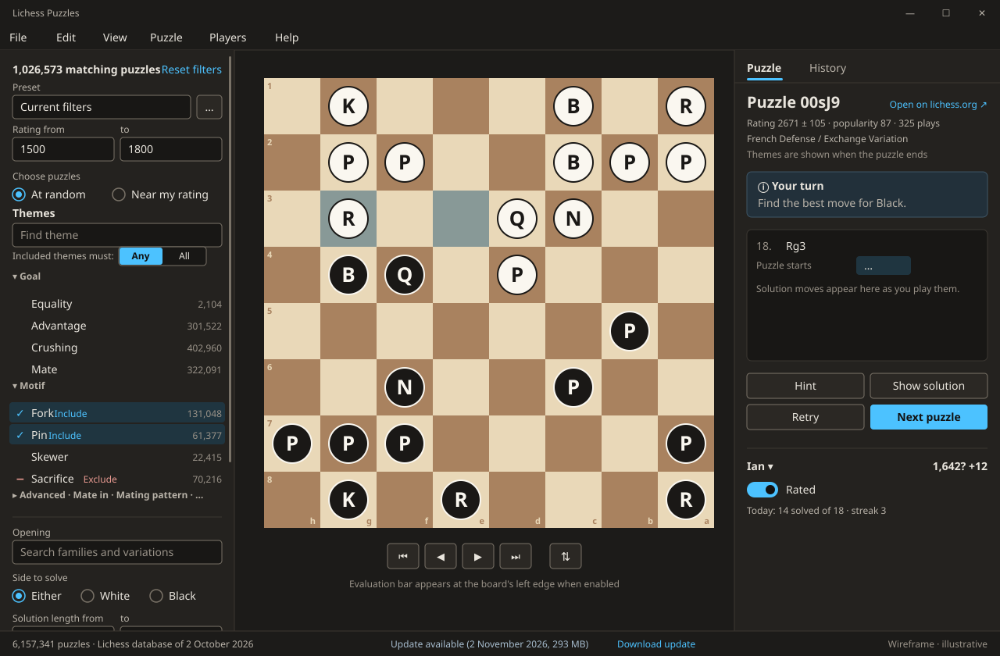

# Lichess Puzzles: workbench layout

Working specification · 24 October 2026 · Stage 2 of the [project brief](project-brief.md)

30 October 2026 selection update: [puzzle selection](puzzle-selection.md) adds opt-in short-mate screening, explicit near-rating ranges and background candidate preparation. The original puzzle database remains intact; filter counts are before screening. These controls precede Themes in the existing scrolling filter pane.

The current player's labeled rating summary now sits above both right-pane tabs, with provisional status, rating deviation and rated-puzzle count visible. The older wireframe below predates this change.

This document defines the window's regions, menus, states and keyboard behaviour for the WinUI 3 shell. It follows [Jupiter style standard 1.0](../../_standards/jupiter-style-standard.md), through the shared [Jupiter.UI](../../jupiter-ui/readme.md) library, and the [UI package proposal](../../_standards/jupiter-ui-package_proposal.md). Departures are listed in [jupiter-exceptions.md](jupiter-exceptions.md). The arrangement is the predecessor's (filters left, board centre, puzzle right), adjusted to Jupiter conventions. The [wireframe](workbench-wireframe.svg) is illustrative: it fixes regions and their contents, not exact colours or spacing.



The wireframe is generated by `workbench-wireframe.py`; pieces are drawn as lettered discs.

## Pattern and window

- **Pattern:** canvas workspace with a collection filter. The board gets most of the space; filters and puzzle details sit in side panes.
- **Menu bar:** yes. This is a substantial app with domain menus.
- **No toolbar.** Frequent commands sit beside the board and in the puzzle pane; the menu bar organizes everything.
- **No navigation sidebar.** There is one work area. History is a local view of the puzzle pane.
- **First launch:** 1200 × 800 effective pixels (standard 6.1), clamped to the work area. Later launches restore the previous valid bounds.
- **Minimum size:** 800 × 560. Below 1180 wide the filter pane collapses to an overlay opened from **View > Filters**. Below 700 tall the move list shrinks before the actions do.

## Regions

```text
┌ Title bar (native) ─────────────────────────────────────────────────────────────┐
│ File  Edit  View  Puzzle  Players  Help                                          │
├──────────────────┬──────────────────────────────────────┬────────────────────────┤
│ Filter pane      │ Board area                           │ Puzzle pane            │
│ 320, resizable,  │ evaluation bar · board · coordinates │ 320, resizable         │
│ collapsible      │ move navigation                      │ Puzzle | History       │
├──────────────────┴──────────────────────────────────────┴────────────────────────┤
│ Status bar: database · update notice · running operation                         │
└──────────────────────────────────────────────────────────────────────────────────┘
```

Pane widths are adjusted with `GridSplitter` (8 px hit area) and saved. Both side panes default to 320 and have minimum widths (filter 240, puzzle 300). The board takes the remaining space and stays square.

### Filter pane

Filters apply as they change. A count runs in about 13 ms over the whole store, so there is no **Apply** button. Changes are debounced by 150 ms, and the count updates in place. Changing filters never replaces the puzzle being solved. **Next puzzle** draws from the current filter.

From top to bottom:

1. **Header:** "1,026,573 matching puzzles" (body text, semibold) and **Reset filters**. With no matches: "No puzzles match these filters" and the same Reset.
2. **Preset:** combo box of saved filter presets ("Current filters" when unsaved changes exist), with an overflow menu: **Save as preset…**, **Rename preset…**, **Delete preset**.
3. **Rating:** two `NumberBox` fields, **From** and **To** (step 50), with the database range as placeholder.
4. **Choose puzzles:** radio buttons **At random** (default) or **Near my rating**. Near my rating adds an offset `NumberBox` (−600 to +600, step 50, labelled "Difficulty offset") and shows the resulting target ("Target 1,640 ± 75"). It ignores the rating fields above and says so beneath them while active.
5. **Themes:**
   - A search box ("Find theme"), then **Included themes must: Any / All** (segmented radio buttons).
   - The theme list, grouped (see [Theme groups](#theme-groups)). Each row has the display name, the matching count under the other filters (secondary, right-aligned, tabular figures), and a three-state selector: not used, **Include** (check icon), **Exclude** (minus icon). Clicking a row cycles through the states, and the state is shown by both icon and text label for screen readers. Each group header can be collapsed.
   - The theme description appears as the row's tooltip.
6. **Opening:** `AutoSuggestBox` over families and variations, with counts; chosen openings appear as removable tokens below it. Matching any chosen opening is enough. "Puzzles without an opening tag are excluded while an opening is chosen" is stated under the field.
7. **Side to solve:** **Either**, **White**, **Black**.
8. **Solution length:** **From** and **To** moves (1–17), counting the solver's moves.
9. **Quality** (expander, collapsed by default): maximum rating deviation, minimum popularity (−100 to 100), minimum plays.
10. **Played puzzles:** check box **Skip puzzles this player has played**.

The pane scrolls as a whole. Field labels stay visible; values outside a field's range are corrected on leaving the field, with an inline note.

### Board area

- **Board:** square, centred, as large as the area allows. Coordinates sit on the board edge (setting). Oriented from the solver's side when each puzzle loads; **Flip board** turns it until the next puzzle.
- **Input:** click a piece then a square, or drag. Legal destinations are shown as dots (rings on captures) for the selected piece. Promotion opens a four-piece picker over the promotion square; Escape cancels it. Only the solver's moves are accepted while solving. After the puzzle ends, the line can be stepped through but not extended.
- **Markers:**
  - The last move is tinted with the accent.
  - The selected square has an accent outline.
  - The hint square is outlined, with a "Hint" label in the puzzle pane.
  - A wrong move shows an error-coloured cross marker on its destination before it is taken back.
  - A correct move shows a success-coloured check marker on its destination.

  Each marker is accompanied by status text, so colour is never the only signal.
- **Evaluation bar** (when evaluation is on and visible): a thin vertical bar at the board's left edge. Its tooltip and accessible name give the score ("+1.4 for White, depth 14").
- **Move navigation** below the board: **First**, **Back**, **Forward**, **Latest** (icon buttons with tooltips and shortcuts), and **Flip board**, set apart by a gap. They are disabled with a tooltip reason while the opponent's move is animating.
- **Board colours** are a content palette (Settings > Appearance > Board), not the accent. The default is a warm brown pair; the choice is saved.

### Puzzle pane

A `SelectorBar` at the top switches between **Puzzle** and **History**. Both keep their scroll position and selection.

#### Puzzle view

1. **Puzzle header:**
   - "Puzzle 00sJ9", selectable and copyable, plus **Open on lichess.org** (link icon).
   - One line of facts: "Rating 2671 ± 105 · popularity 87 · 325 plays".
   - Opening family / variation, using display names ("French Defense / Exchange Variation").
   - Themes: hidden while solving unless **Show themes while solving** is on ("Themes are shown when the puzzle ends"); shown as text tokens afterwards.
2. **Prompt:** an `InfoBar`-styled region that always shows the current state (see [Puzzle states](#puzzle-states)), with title and message, for example "Your turn" / "Find the best move for Black." It is announced to screen readers as a live region.
3. **Move list:** SAN in two columns with move numbers. The opponent's first move is shown, followed by a "Puzzle starts" marker. Solver moves appear as they are played. Clicking a move shows that position; the current move has the selected-surface background. After the puzzle ends the whole solution is listed.
4. **Actions:** **Hint** and **Show solution** (neutral), **Retry** (neutral), **Next puzzle** (the one accent button). Unavailable actions are disabled with a reason in their tooltip ("Available while solving").
5. **Player:** player name with a drop-down (switch player, **New player…**, **Manage players…**). It shows the rating ("1,642?" while provisional, deviation in the tooltip) and the change from the last rated puzzle ("+12", with "rating up" in its accessible name). Below are the toggle **Rated** and one line of today's results ("Today: 14 solved of 18 · streak 3").
6. **Evaluation** (expander, shown only when evaluation is enabled in Settings): score, principal variation in SAN, depth. Hidden while solving unless **Show while solving** is on.

#### History view

A table of the current player's played puzzles, newest first. Columns:

- **Played** (date and time)
- **Puzzle** id
- **Rating**
- **Result**: "Solved", "Solved with help" or "Failed", always as text
- **Mistakes**
- **Hints**
- **Time**
- **Rating change**, when rated

Sort by any column. Above the table: a filter (**All**, **Solved**, **Solved with help**, **Failed**) and totals ("412 played · 71% solved cleanly · best streak 19"). Double-click or Enter opens a puzzle again, as an unrated replay. Context menu: **Open puzzle**, **Open on lichess.org**, **Copy puzzle id**. With no history: "No puzzles played yet by this player."

### Status bar

One row, 32 px, with three parts:

- **Database** (left): "6,157,341 puzzles · Lichess database of 2 October 2026". Clicking it opens **Database details**.
- **Notice** (centre, when applicable): "Update available (2 November 2026, 293 MB)" with **Download update**, or "Update ready" with **Switch to new puzzles**. Network and build failures appear here with **Retry** and **Details**.
- **Operation** (right, while one runs): the phase and a determinate progress bar ("Downloading 112.4 of 293.0 MB · 2.1 MB/s · about 1 min left", "Building store · 41%"), with **Pause** (downloads) and **Cancel**. The rest of the window stays usable.

## Menus

Shortcuts listed here are the only ones reserved. A shortcut is shown in a menu only when its command works in the current state; otherwise the item is disabled.

**File**

| Item | Shortcut | Notes |
| --- | --- | --- |
| Download puzzles… | | First download, or **Download update** when one is available |
| Check for update | | One HEAD request; result in the status bar |
| Import puzzle file… | | `.csv` or `.csv.zst`; builds a store from it |
| Export matching puzzles… | Ctrl+E | Dialog: PGN, CSV or EPD; PGN start (opponent's move or solver's position); destination |
| Export played puzzles… | | Current player's history as PGN |
| Export puzzle as PGN… | Ctrl+Shift+E | Current puzzle |
| Database details… | | Dialog, see below |
| Settings | Ctrl+, | |
| Exit | Alt+F4 | |

**Edit**

| Item | Shortcut |
| --- | --- |
| Copy FEN | Ctrl+Shift+C |
| Copy PGN | |
| Copy puzzle link | |

Ctrl+C keeps its ordinary meaning in text fields and selectable text.

**View**

| Item | Shortcut |
| --- | --- |
| Filters (toggle pane) | Ctrl+Shift+F |
| Puzzle | Ctrl+1 |
| History | Ctrl+2 |
| Flip board | F |
| Coordinates (toggle) | |
| Evaluation (toggle; disabled until enabled in Settings) | |
| Show evaluation while solving (toggle) | |

**Puzzle**

| Item | Shortcut |
| --- | --- |
| Next puzzle | Ctrl+N |
| Hint | Ctrl+H |
| Show solution | Ctrl+Shift+H |
| Retry | Ctrl+R |
| Go to puzzle… | Ctrl+G |
| First move / Back / Forward / Latest move | Home / Left / Right / End |
| Rated (toggle) | |
| Open on lichess.org / Open source game | |

**Players:** the list of players (radio items, current checked), **New player…**, **Rename player…**, **Delete player…**, **Clear history…**.

**Help:** **Keyboard shortcuts** (F1), **Theme descriptions**, **About Lichess Puzzles**.

## Dialogs and secondary windows

All are `ContentDialog` unless noted. Each has one primary action named by its verb.

- **Go to puzzle:** a dialog from the Puzzle menu or Ctrl+G, with a single field ("Puzzle id or lichess.org link"). It shows "No puzzle 'xxxxx' in this database" inline when the id is unknown.
- **New / Rename player:** a name field (1–40 characters, unique). Primary **Add player** / **Rename**.
- **Delete player:** "Delete Ian, with a rating of 1,642 and 412 played puzzles? This cannot be undone." Primary **Delete player**. Not offered for the last remaining player.
- **Clear history:** names the player and count. Primary **Clear history**. The rating is kept.
- **Export matching puzzles:** format, PGN start option, the match count, and a destination with **Browse**. The export runs in the status bar.
- **Database details:**
  - The store: puzzles, size, built date, skipped rows with **Review skipped rows**.
  - The source: file, date, ETag, whether it is kept.
  - The data folder with **Show folder**.
  - Actions: **Check for update**, **Rebuild store**, **Import puzzle file…**
- **Settings** (a page in its own window, opened from File):
  - **Appearance:** the shared **Accent color** control; **Board** colours; **Pieces**; **Coordinates**; **Move animation** (Off, Fast, Normal; Off when Windows animations are off).
  - **Puzzles:** **Show themes while solving** (off); **Opponent's move delay** (0.3–2 s, default 0.6 s); **Go to the next puzzle after a clean solve** (off).
  - **Evaluation:** **Enable evaluation** (off); **Show while solving** (off); **Time per position** (0.5–5 s).
  - **Storage:** **Data folder** with Browse and Show folder; **Keep the downloaded file after building** (on); **Check for updates when the app starts** (on).

  Changes apply immediately.

## Application states

| State | Filter pane | Board area | Puzzle pane | Status bar |
| --- | --- | --- | --- | --- |
| **No database** (first run) | Controls shown, disabled; "Filters are available once puzzles are installed" | Empty-state panel: "No puzzles installed", "The Lichess puzzle database is about 300 MB to download and 500 MB once installed." **Download puzzles** (accent), **Import puzzle file…** | Player only | "No puzzle database" |
| **Downloading** (first) | Disabled | Panel shows the same progress as the status bar, with **Pause** and **Cancel** | Player only | Progress, Pause, Cancel |
| **Paused / interrupted** | Disabled | "Download paused at 112 MB of 293 MB." **Resume download** | Player only | "Download paused" |
| **Building** (first) | Disabled | Panel: "Building the puzzle store", determinate progress, **Cancel** | Player only | Progress |
| **Ready** | Live | Current puzzle | Puzzle view | Database summary |
| **Ready, no matches** | Header "No puzzles match these filters", **Reset filters** | Current puzzle stays | **Next puzzle** disabled: "No puzzles match the filters" | Unchanged |
| **Update downloading / building** | Live | Current puzzle; play continues on the current store | Unchanged | Progress, Pause, Cancel |
| **Update ready** | Live | Unchanged | Unchanged | "Update ready" with **Switch to new puzzles**; switching keeps the current puzzle if its id exists |
| **Store damaged or wrong version** | Disabled | Panel: "The puzzle store can't be read", the reason, **Rebuild store** (when the download is kept) or **Download puzzles** | Player only | Error notice |
| **Operation failed** | As before | As before | As before | Error notice: what failed, what is affected ("Your current puzzles are unchanged"), **Retry**, **Details** |

On launch with a usable store, the puzzle that was in progress is restored, with the moves already played. If it was finished, or none was in progress, the next puzzle is drawn.

The store is replaced only after the new one is built completely. Because Windows cannot rename over a mapped file, the shell closes the old store before the core moves the new one into place.

## Puzzle states

| State | Prompt (title / message) | Board | Actions enabled |
| --- | --- | --- | --- |
| **Opponent to move** | "Opponent's move" / "Watch the move that sets up the puzzle." | Shows the FEN position, then animates the first move after the delay | Next puzzle |
| **Solving** | "Your turn" / "Find the best move for White." | Accepts solver moves | Hint, Show solution, Next puzzle |
| **Correct, continuing** | "Best move" / "Keep going." | Success marker; the opponent's reply follows after the delay | As Solving |
| **Wrong move** | "Not the move" / "Try again." (after a rated loss: "Try again. This puzzle now counts as failed.") | Error marker, move taken back after 0.6 s | As Solving |
| **Hint shown** | "Hint" / "Move the highlighted piece." | Hint square outlined | As Solving |
| **Solved** | "Solved" / "Clean solve. Rating 1,654 (+12)." | Free navigation; themes revealed | Retry, Next puzzle (focused) |
| **Solved with help** | "Solved with help" / "1 mistake, 1 hint. Rating 1,630 (−12)." | As Solved | Retry, Next puzzle |
| **Solution shown** | "Solution" / "Step through the moves with the arrow keys." | Plays the remaining line, then free navigation | Retry, Next puzzle |
| **Replay** (Retry, or opened from History) | As above, with "Replay; not rated" in the message | As above | As above |

Rules carried over from the predecessor:

- Any move that delivers checkmate is accepted as completing the puzzle.
- The rated result is settled by the first wrong move, hint or solution (a loss). A completed solve without any of these is a win.
- Puzzles played before, and play with **Rated** off, never change the rating.
- Leaving a puzzle with **Next puzzle** after a wrong move, hint or played move records it as failed.

## Keyboard

Focus order is: menu bar (Alt or F10), filter pane, board, navigation buttons, puzzle pane, status bar. **F6** and **Shift+F6** move between these regions.

| Key | Where | Action |
| --- | --- | --- |
| Left / Right | Anywhere except text fields and a focused board | Back / forward one move |
| Home / End | As above | First position / latest position |
| Up / Down | Move list | Previous / next move |
| Ctrl+Left / Ctrl+Right | Board focused | Back / forward one move |
| Arrow keys | Board focused | Move the square cursor (outlined in the focus colour) |
| Enter or Space | Board focused | Select the piece under the cursor, or move the selected piece to the cursor |
| Escape | Board | Clear the selection or close the promotion picker |
| Q, R, B, N | Promotion picker open | Choose the promotion piece |
| F | Anywhere except text fields | Flip board |
| Ctrl+N, Ctrl+H, Ctrl+Shift+H, Ctrl+R, Ctrl+G | Window | Next puzzle, hint, show solution, retry, go to puzzle |
| Ctrl+1 / Ctrl+2 | Window | Puzzle / History view |
| Ctrl+Shift+F | Window | Show or hide the filter pane, moving focus into it when shown |
| Ctrl+E, Ctrl+Shift+E, Ctrl+Shift+C, Ctrl+, | Window | Export matching, export the puzzle as PGN, copy FEN, settings |
| Enter | Filter fields | Commits the field; never starts a puzzle or an export |
| F1 | Window | Keyboard shortcuts |

The board is a single focusable element exposing a grid to UI Automation. The square under the cursor is announced as "e4, white knight" or "e4, empty". Moves are announced in words after they are played ("Black: knight takes e4, check"), and the prompt region announces state changes. Pieces and markers have contrast-theme equivalents, and move animation follows Windows animation settings.

## Theme groups

Display names and descriptions come from [`themes.jsonl`](<D:/GitHub/lichess-puzzles/themes.jsonl>). The mapping from CSV key to group, name and description becomes a table in the core. Groups appear in this order:

| Group | Keys |
| --- | --- |
| Goal | equality, advantage, crushing, mate |
| Length | oneMove, short, long, veryLong |
| Phase | opening, middlegame, endgame, rookEndgame, bishopEndgame, knightEndgame, pawnEndgame, queenEndgame, queenRookEndgame |
| Motif | advancedPawn, attackingF2F7, capturingDefender, discoveredAttack, discoveredCheck, doubleCheck, exposedKing, fork, hangingPiece, kingsideAttack, pin, queensideAttack, sacrifice, skewer, trappedPiece |
| Advanced | attraction, clearance, collinearMove, defensiveMove, deflection, interference, intermezzo, quietMove, xRayAttack, zugzwang |
| Mate in | mateIn1, mateIn2, mateIn3, mateIn4, mateIn5 |
| Mating pattern | anastasiaMate, arabianMate, backRankMate, balestraMate, blindSwineMate, bodenMate, cornerMate, doubleBishopMate, dovetailMate, epauletteMate, hookMate, killBoxMate, morphysMate, operaMate, pillsburysMate, smotheredMate, swallowstailMate, triangleMate, vukovicMate |
| Special move | castling, enPassant, promotion, underPromotion |
| Origin | master, masterVsMaster, superGM |

This covers all 73 keys in the current database. A key not in the table appears under **Other** with its key as its name, so a new Lichess theme is filterable before the table is updated.

Opening tags are shown with underscores as spaces, and with the family prefix removed from the variation ("French_Defense_Exchange_Variation" → "Exchange Variation").

## Persistence

Settings and state are kept in `%LOCALAPPDATA%\Jupiter\LichessPuzzles`:

- `ui.json`: window bounds, pane widths and visibility, puzzle pane view, collapsed theme groups.
- `settings.json`: the settings above, the current filters and presets.
- `players.sqlite`: players, ratings, history and the puzzle in progress.

The store and download stay where the core puts them.

## Core work implied

The core proof covers the download, store and filters. The shell also needs:

1. **Theme catalogue:** group, display name, description; opening display names.
2. **Filters:** exclusion of played puzzles (a per-player bitset over record indices), and target-rating selection with widening when nothing is near.
3. **Puzzle session:** state machine (opponent's move, solving, correct, wrong, hint, solved, solution shown, replay), mate acceptance, the hint square, navigation over the line.
4. **Players:** Glicko-2 ratings, history and the puzzle in progress in SQLite; presets in settings.
5. **Export:** PGN (with both start options and the `Puzzle*` tags), CSV and EPD.
6. **Evaluation engine:** on a worker thread, with a time limit and cancellation.
7. **Store replacement** that closes and swaps safely; the update check at start.
8. **C ABI and protobuf messages** for all of the above, following the Chess.com Crawler boundary: commands return quickly, long operations report through polled events.

## Decisions

Ian accepted all six on 24 October 2026:

1. Live filters with no Apply button.
2. Themes hidden while solving by default.
3. History as a view of the puzzle pane rather than a separate window.
4. Update check at start on by default (one HEAD request).
5. Flip board on F without a modifier.
6. The default board colours, and the piece set given the Merida licence question in the brief.

## Implementation status (24 October 2026)

Stages 4 and 5 implement this specification, with these differences:

- **Near my rating:** the rating fields still apply, together with the target window, rather than being ignored. The filter pane says so beside the target.
- **Player strip:** the player menu offers New, Rename, Delete and Clear history directly instead of a separate **Manage players…** dialog.
- **Data folder:** shown with **Show folder** in Settings and Database details. It cannot yet be moved.
